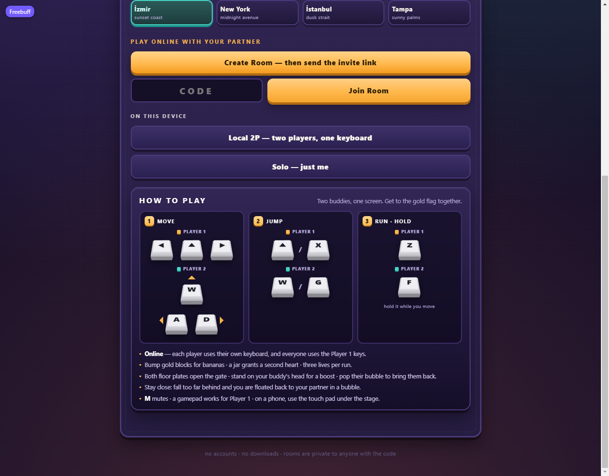
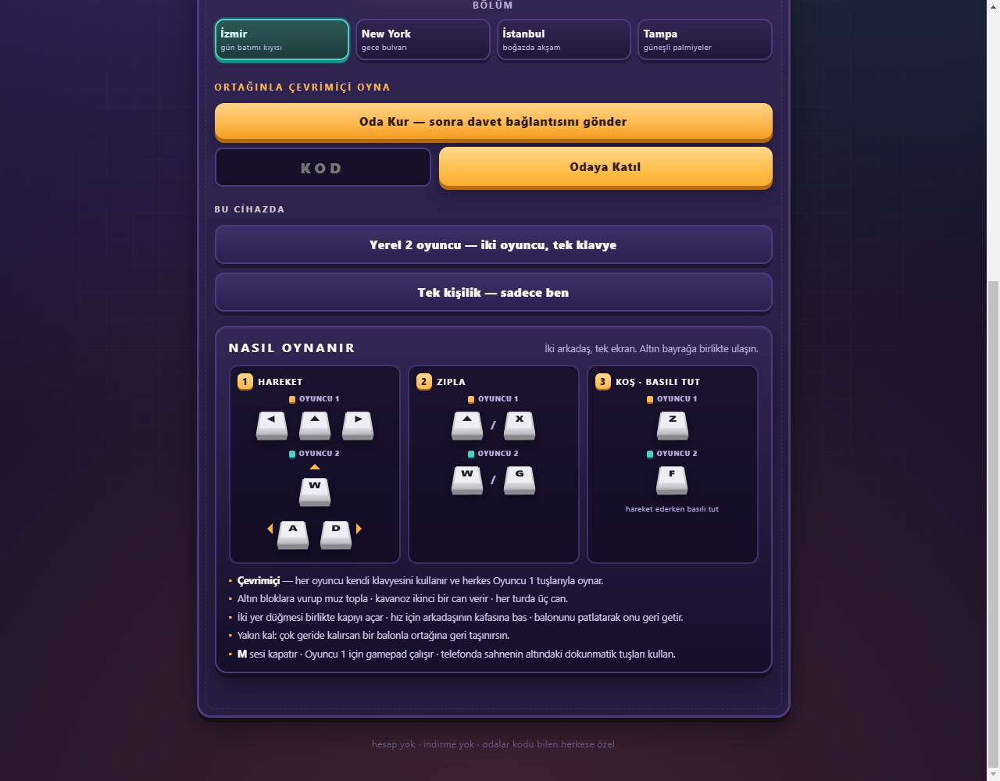
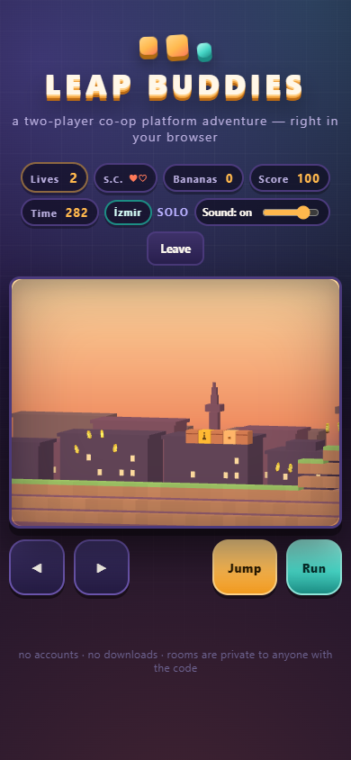
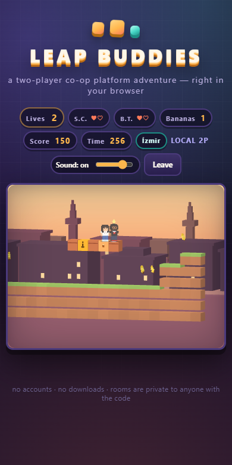
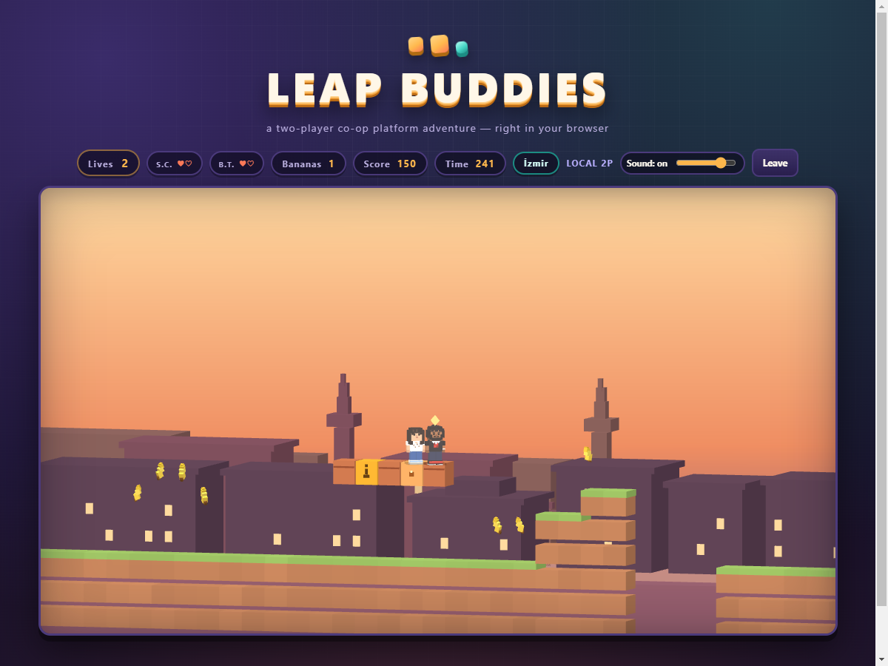

# Leap Buddies

**A two-player co-op platform adventure that runs in the browser.**
No installs, no accounts, no downloads — pick a city, share a room code,
and cross a hand-built voxel world together.

Leap Buddies is an original game: its own characters, level layout,
mechanics, art and music, all generated in code. Two buddies, **S.C.**
and **B.T.**, hop across four cities to reach the gold flag at the end of
each stage while collecting bananas, opening gates with floor plates, and
keeping each other out of trouble.

Deploy target: **<https://xiondigital.net/leapbuddies>** (see the deploy
section at the bottom).

---

## Play

Open the page and choose a stage, then:

| Mode | What it is |
|---|---|
| **Solo** | Cross the level alone. Every jump, gate and rescue works with one player. |
| **Local 2P** | Two players, one keyboard. |
| **Online co-op** | One player creates a room, shares the 5-letter code or the invite link, both ready up and the host starts. Each player uses their own keyboard with the Player 1 keys. |

Online rooms are host-authoritative: whoever created the room runs the
simulation and the guest plays into it, so both players always see the
same world. The host also picks the stage so the two of you get the same
skyline and the same music.

### Controls

| | Move | Jump | Run (hold) |
|---|---|---|---|
| **Player 1** | ← → | ↑ or X | Z |
| **Player 2** | A D | W or G | F |

A gamepad works for Player 1. **M** mutes. The menu has a permanent
**How to play** panel with three numbered cards — **1 Move**, **2 Jump**,
**3 Run** — and each key drawn as a plain white 3D keycap with its legend
on top, so someone who has never played a platformer can match the letters
on their own keyboard at a glance.

### Language, sound, touch

- **English / Türkçe** — the switch sits at the top right of the main menu.
  It translates every string in the game — menu, lobby, HUD, how-to-play,
  status lines and the end-of-run summary — and remembers the choice, so a
  Turkish browser opens in Turkish the first time.
- **Volume** — a slider next to the sound button in the game HUD, wired to
  the master level of the synth, so effects and music move together. Both
  the slider and the mute state are remembered.
- **Touch** — on a touch-first device a pad appears just below the stage:
  ◀ ▶ on the left, Jump and Run on the right. It is hidden on desktops and
  laptops that have a mouse, even if the screen is also touch-sensitive.
  Letting go of a button always releases it; `?touch=1` / `?touch=0` on the
  URL forces the pad on or off.

---

## Screenshots











---

## How a run works

- **Three lives.** Deaths and game overs are the only things that end a run.
- **Hearts** are how many hits you can take: one by default, two while a
  hazelnut-spread jar is active. A hit on two hearts just shrinks you and
  grants a moment of flashing invulnerability; a hit on one heart is a down.
- **Losing a life pops the character out of view** — a quick hop, a spin
  and a puff of voxel bits at the spot where they last stood — then they
  return at the checkpoint. A pit fall pops at the ledge rather than
  animating out of sight under the floor.
- **Solo down** (enemy, pit or running out of time) costs a life and puts
  you back at the last checkpoint.
- **Co-op down** leaves you floating in a bubble. No life is lost — your
  partner jumps into the bubble to pop it. If your partner goes down while
  you are already bubbled, nobody is left to save the team: that costs a
  life and both of you restart at the checkpoint.
- **Catch-up bubble.** In co-op the camera follows whoever is in front. If
  one player falls more than about fifteen tiles behind and off the left
  edge of the screen, they are lifted into a bubble and flown back to their
  partner instead of being stranded off-screen or dragging the camera onto
  the player in front.
- **Bananas and jars.** Bananas are scattered through every stage; gold
  blocks pay out when bumped from below; jars grant the second heart.
- **Gate.** Both floor plates must be pressed at once (one in solo) to open
  the gate blocking the midpoint.
- **Checkpoint and goal.** Touching the midpoint flag moves your respawn
  point. Reaching the gold flag clears the stage.
- **Timer.** Five minutes per stage. Running out costs a life.
- **Readable at any size.** The camera zooms in on small screens until a
  buddy is at least 26 screen pixels tall, then pulls back out far enough
  that a co-op partner stays in the frame — see
  [Camera and zoom](#camera-and-zoom).

### End of a run

Clearing the flag or running out of lives opens a summary card over the
stage: score, bananas, time (or how long you survived), lives left, and
your **best score and best time for this stage in this mode**, with a
`NEW` tag on anything you just beat. The host and the guest each keep
their own records; the guest's card waits for the host to restart.

Records are grouped by stage and by mode — **Solo**, **Local 2P** and
**Online co-op** (host and guest share the online row, since it is the
same pair playing the same stage). They live in `localStorage` under
`leapbuddies.best.v1`, so they survive reloads but stay on that one
browser. Only a cleared stage can set a best time; a game over can still
take the best score. If storage is blocked the game keeps going and the
records simply do not persist.

---

## The four cities

Each stage is its own palette, skyline and music loop. All four share one
verified level layout, so online sessions, checkpoints and timing behave
identically wherever you play.

| Stage | Look | Music |
|---|---|---|
| **İzmir** | sunset coast, terracotta blocks, minarets | bright bouncy loop in C |
| **New York** | midnight avenue, lit towers | walking bass, off-beat lead, kick + snare |
| **İstanbul** | dusk over the strait, domes and minarets | harmonic-minor melody over dum/tek percussion |
| **Tampa** | sunny palms, low teal skyline | 80s summer pop — straight beat, gated stabs |

The music is synthesised at runtime by a tiny WebAudio step sequencer:
one lead line, one bass line and a three-piece drum kit per stage, at most
32 steps each. There are no audio files.

---

## Design notes

- **One screen, two people.** Every rule has to work for a solo player and
  for two people sharing a couch or a room code. Gates take one plate in
  solo and two in co-op; a downed partner is a bubble you can pop rather
  than a lost life; the camera follows whoever is ahead and carries a
  straggler back instead of stranding them.
- **Readable before pretty.** A voxel letter on a 50-pixel keycap is a grey
  smudge, so the keycaps use drawn legends. A 22-unit buddy in a 512-unit
  world is fourteen pixels on a phone, so the camera zooms. The visual
  rules come from what a new player can actually identify.
- **Everything is generated.** Models, skylines, keycaps, character cards
  and music are code. The repository holds no textures, no audio files and
  no models — which is also why it can be a static site.
- **No accounts, no server.** Rooms are name-based channels on a public
  relay; records live in `localStorage`. Nothing to sign up for, nothing to
  leak, nothing to pay for.
- **Two languages, equal.** Turkish is a first-class language here, not a
  translation layer bolted on: stage names, tags and summaries are written
  in both.

---

## How it works

- **Simulation** — [js/engine.js](js/engine.js) is plain JavaScript with no
  DOM or canvas dependency. It runs at a fixed 60 Hz step and also runs
  headless in Node, which is what the test suite exercises.
- **Rendering** — [js/render3d.js](js/render3d.js) draws the world with
  Three.js (r149, pinned, from CDN). Every model — the two buddies, the
  critters, tiles, bananas, the spread jar, switches, gate, flags, moving
  platforms and all four skylines — is assembled at load time from
  axis-aligned boxes with flat vertex colours. There are no model or
  texture files anywhere in the repository.
- **Camera** — a locked three-quarter orthographic side view over the same
  512×288 play area as the original 2D layout. The fixed yaw and pitch are
  what give the boxes their voxel read: side faces catch the directional
  light and the top surfaces stay bright. Skylines are three instanced
  parallax layers.
- **Zoom** — [js/camera.js](js/camera.js) is pure framing maths (no THREE,
  no DOM) that decides the frustum every frame; see below.
- **Characters** — merged geometry split into six animated parts (torso,
  head, arms, legs) with limb swing, bob, landing squash and a skid lean.
  S.C. wears a black tee, chain and red sneakers; B.T. has long dark-brown
  hair, a dotted blouse and jeans. The character-select cards and the menu
  keycaps are rendered live from the same code into small canvases.
- **Budget** — tiles are one `InstancedMesh` and are rebuilt only when a
  block changes; bananas are a second instanced mesh. The scene stays near
  30k triangles and a couple of dozen draw calls, and rendering pauses
  while the tab is hidden.
- **Audio** — [js/audio.js](js/audio.js) synthesises every sound effect and
  loop with WebAudio oscillators plus one shared noise buffer for drums.
  One master level scales every voice, so the HUD slider moves music and
  effects together while mute stays a separate switch.
- **Text** — [js/i18n.js](js/i18n.js) holds every player-facing string in
  English and Turkish. Markup opts in with `data-i18n` attributes (plus
  `-html`, `-placeholder`, `-title`, `-aria` variants); anything the UI
  builds in code goes through `I18n.t()`. The chosen language is stored in
  `localStorage` and applied to `<html lang>`, the page title and the meta
  description as well.
- **Keycaps** — the caps are real 3D boxes rendered into small canvases,
  but the legend is a texture on the cap face rather than voxel letters:
  at 50 px a letter built from cubes turned into a grey blur, which is
  exactly what a new player cannot read.
- **Netcode** — [js/net.js](js/net.js) uses Supabase Realtime broadcast
  channels purely as a message relay: the two browsers each open one
  outbound WebSocket, so there is no peer negotiation, no ICE and nothing
  to port-forward. The host streams compact state snapshots about 20 times
  a second; the guest sends inputs and interpolates between snapshots.
  No database, no sessions, no stored data.

### Camera and zoom

The world is 512 units wide and a buddy is 22 units tall. Squeezing that
into a 317-pixel-wide phone draws the buddy about fourteen pixels high —
visible, but not something you can land a jump with. The camera therefore
frames the action instead of the level:

- **Readable first.** The frustum half-height is solved so a buddy renders
  at least **26 CSS pixels** tall. A 390 × 280 phone stage zooms in about
  1.6×, a 360-pixel phone about 1.8×, and a 768-pixel tablet or any desktop
  fits the old fixed view exactly (zoom 1), so nothing changes there.
- **Never lose your partner.** The zoom is capped by the gap between the
  two live buddies: half the gap plus one body width of padding becomes the
  minimum half-width, so the camera pulls back out (and slides to the
  midpoint between them) whenever the pair separates. At 240 units apart on
  a 320-pixel phone both are still whole in frame. An absent partner — solo
  play, or someone mid-respawn — is ignored.
- **Level-aware.** The frame is clamped to the level's start and end, so
  zooming never reveals an empty void beside the first platform.
- **Bottom-anchored.** Zoom trims the sky, not the ground: the ground line
  stays where it was and the buddy keeps the same footing on screen.
- **Calm movement.** Zooming out to keep a partner visible is fast (12/s);
  drifting back in is slow (4.5/s), and the centre eases rather than cuts.
  Rotation snaps to the new framing immediately.

The maths is testable on its own: `frame()` returns the frustum halves, the
look-at point and a `zoom` factor. `?zoom=0` on the URL pins the old fixed
view, which is handy when comparing screenshots.

### Why there is no server

The game is a static site. Connectivity is the relay above, which needs
only the public anon key already in [js/net.js](js/net.js) — that key is
designed to be public and grants no privileges beyond joining channels.
Hosting therefore stays with GitHub Pages and the web server, with no
Vercel functions, no build pipeline and no secrets to rotate. If the relay
project is ever replaced, swap `SB_URL` / `SB_ANON` in that one file.

Room privacy is name-based: a room only exists while two browsers are in
the same 5-letter channel, and the code is the only key. Anything more
elaborate would need a server and is deliberately out of scope.

---

## Files

```
index.html            page shell: menu, lobby, game, how-to-play
style.css             voxel-cube UI theme
js/engine.js          simulation, level data, snapshots (runs headless)
js/camera.js          zoom + co-op framing maths (runs headless)
js/render3d.js        Three.js voxel renderer, models, stages, previews
js/audio.js           WebAudio effects and the four stage loops
js/net.js             relay transport: room codes, host/join
js/progress.js        local best scores and best times, per stage and mode
js/i18n.js            every player-facing string, English and Turkish
js/main.js            UI, lobby, fixed-timestep loop, netplay glue
tests/smoke-node.js   headless mechanics, lives and netcode checks
```

## Run it locally

Any static file server works — there is no build step:

```bash
python -m http.server 8080
# then open http://localhost:8080/
```

Opening `index.html` straight from disk mostly works, but online play
needs an `https://` or `localhost` origin for the WebSocket and clipboard.

## Tests

```bash
node tests/smoke-node.js
```

101 headless checks: level data, movement, gate (solo and two-plate forms),
head bounce, jars, checkpoints, goal, the full lives model (solo deaths,
three-strike game over, co-op bubbles, partner-down team wipes, timeout,
respawn hearts, death pop placement), the camera split and catch-up
bubble, snapshot round trips, the abusive-input fuzz run, the four stage
themes, the run clock, the local records (first clear, weaker runs,
score-only game overs, separate rows per stage and mode, fastest-clears-only
times, and the storage key), the translation tables (every English key has a
Turkish one, and every `data-i18n` hook in the page and every `T()` key used
by the UI resolves), the volume range, and the camera framing (desktop stays
at zoom 1, a phone zooms in until the buddy is 26 px tall, a split pair stays
whole in frame, the frame never leaves the level, and `zoom: false` restores
the fixed view).

Rendering, the how-to-play keycaps, local 2P and online co-op are verified
in a browser: two tabs, invite link, ready, start, guest input, carry
bubble, game over, restart, disconnect. The summary card is checked at
desktop, tablet and phone widths, and its records are checked across a
reload, a weaker retry, a stage clear, and switching stage and mode. Both
languages are checked on the menu, lobby, HUD and summary; the touch pad is
driven with real pointer events to confirm move, jump and run, and the
volume slider is checked across a reload. The zoom is measured at 1200,
768, 390 and 360 CSS pixels and with the pair 240 units apart: desktop and
tablet stay at the fixed framing, the phone frames render the buddy at
26 px, and both buddies remain inside the canvas when they split.## Deploying

This repository **is** the deployment. There is no build step, no output
directory and no server-side code: GitHub Pages serves the repository root
as a project page under the existing custom domain.

| URL | What serves it |
|---|---|
| <https://xiondigital.net/leapbuddies/> | the `main` branch of `XiONDiGiTaL/leapbuddies`, project page |
| <https://xiondigital.net/ux-session/> | a tiny redirect page (formerly this repo) → `/leapbuddies/` |
| <https://github.com/XiONDiGiTaL/leapbuddies> | the source |

Pages is configured with **Source: Deploy from a branch**, branch `main`,
folder `/ (root)`. The `CNAME` for `xiondigital.net` lives on the user site
(`XiONDiGiTaL/xiondigital.github.io`), so any project repository
immediately gets `xiondigital.net/<repo-name>/` — no per-repo DNS work.

To publish a new build:

1. Bump the `?v=` query on the stylesheet and every script in
   [index.html](index.html) (`?v=32` today). GitHub Pages caches files for
   minutes; a version bump is what makes a release land immediately in
   browsers that already have the old files.
2. `git push` to `main`. Pages rebuilds automatically; the deployment
   status is visible under **Settings → Pages** or with
   `gh api repos/XiONDiGiTaL/leapbuddies/pages/builds/latest`.
3. Hard-reload once on a phone. Online rooms need an HTTPS origin, which
   Pages provides.

Keeping `/ux-session` alive is deliberate: links shared before the rename
still land on the game. That repository contains only a redirect
`index.html` (and its own Pages enablement), nothing to maintain.

The same folder also deploys unchanged to any static host on a subpath —
a Vercel project pointed at the repository root with no framework preset,
Cloudflare Pages, or plain nginx — because every URL in the page is
relative. Vercel is not used today, so nothing needs configuring there.

## Credits

Code, art, level design and music are original work for Leap Buddies.
Libraries: [Three.js](https://threejs.org) (MIT) and
[supabase-js](https://supabase.com/docs/reference/javascript) (MIT),
both loaded from a CDN. The hazelnut-spread jar in the game is an
original voxel model; the spread brand it references is a trademark of
its owner and is not affiliated with this project.
